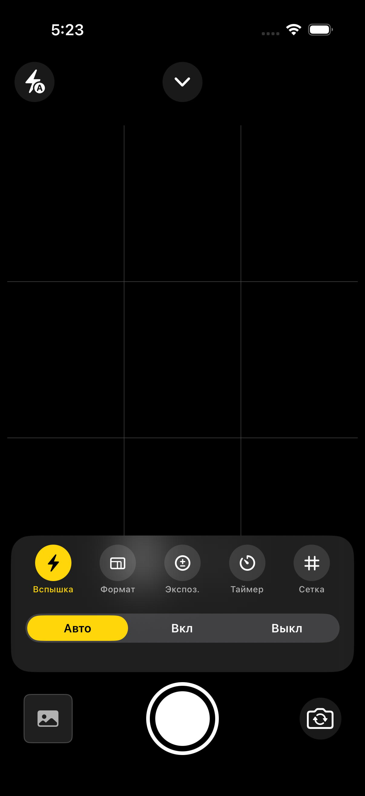
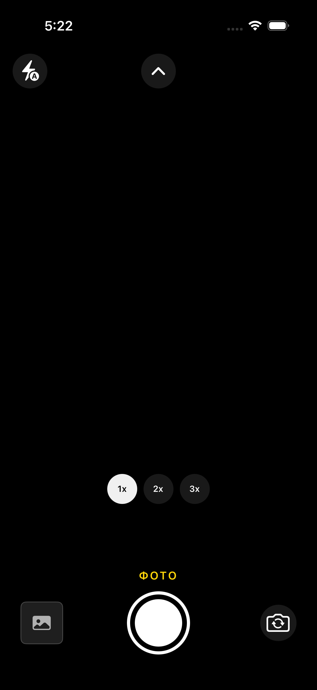

# iPhone 6 Camera

[](https://github.com/homik-ori/iPhone6Camera/actions/workflows/build.yml)
[](https://github.com/homik-ori/iPhone6Camera/releases/latest)

Нативное iOS-приложение для съёмки с видом камеры iPhone 6 (2014): мягкая картинка без современной цифровой резкости, Smart HDR и Deep Fusion. Интерфейс повторяет приложение «Камера» из iOS 15.

Проект на Swift и UIKit, без CocoaPods и SPM. Используются только AVFoundation, Core Image и Photos.

<p align="center">
  
  
</p>
<p align="center"><sub>Скриншоты из iOS Simulator. В симуляторе нет камеры, поэтому видоискатель чёрный.</sub></p>

## Возможности

- Съёмка через основной широкоугольный объектив `builtInWideAngleCamera`.
- `photoQualityPrioritization = .speed` — минимум вычислительной обработки при захвате.
- Приведение кадра к 8 Мп: 3264 × 2448 для 4:3, 3264 × 1836 для 16:9 и 2448 × 2448 для 1:1.
- Мягкая цветокоррекция Core Image: небольшое размытие, вытягивание теней, тёплый баланс белого и слабое зерно.
- Автосохранение JPEG с качеством 0.85 в «Фото».
- Вспышка: авто / вкл / выкл.
- Форматы кадра 4:3, 16:9 и 1:1 с плавной сменой рамки.
- Коррекция экспозиции от −2.0 до +2.0 с шагом 0.3.
- Таймер 3 и 10 секунд с обратным отсчётом.
- Сетка правила третей.
- Тап-фокус и свайп по экрану для изменения яркости.
- Фиксация фокуса и экспозиции долгим нажатием.
- Зум 1.0x–5.0x, пинч и полукруглое колесо точной настройки.
- Просмотр последнего снимка, зум и «Поделиться».

## Как получается «вайб iPhone 6»

1. Кадр снимается широкоугольной камерой с приоритетом скорости, чтобы система не успела применить тяжёлую нейровычислительную обработку.
2. Изображение уменьшается до 8 мегапикселей — это убирает микрорезкость современных сенсоров.
3. Core Image слегка смягчает картинку, приглушает света, поднимает тени и добавляет тёплый оттенок.
4. Поверх накладывается монохромное зерно с прозрачностью около 5%.
5. Результат сохраняется в медиатеку отдельным JPEG.

Параметры подобраны вручную и остаются в коде: `PhotoProcessor.swift`.

## Сборка

Нужен macOS с Xcode 15 или новее.

```bash
xcodebuild archive \
  -project iPhone6Camera.xcodeproj \
  -scheme iPhone6Camera \
  -configuration Release \
  -destination 'generic/platform=iOS' \
  -archivePath build/iPhone6Camera.xcarchive \
  CODE_SIGN_IDENTITY="" \
  CODE_SIGNING_REQUIRED=NO \
  CODE_SIGNING_ALLOWED=NO \
  DEVELOPMENT_TEAM="" \
  SKIP_INSTALL=NO
```

Упаковка в IPA:

```bash
mkdir -p build/Payload
cp -R build/iPhone6Camera.xcarchive/Products/Applications/iPhone6Camera.app build/Payload/
cd build && zip -r -y iPhone6Camera.ipa Payload
```

Готовый файл также собирается в GitHub Actions на `macos-latest` и лежит в артефактах каждой сборки.

## Установка

1. Скачайте `iPhone6Camera.ipa` из [последнего релиза](https://github.com/homik-ori/iPhone6Camera/releases/latest).
2. Откройте AltStore → **My Apps → +**.
3. Выберите IPA и подпишите его своим Apple ID.

Файл в релизе не подписан. Для бесплатного Apple ID подпись нужно обновлять раз в 7 дней.

## Структура

```
iPhone6Camera/
├── iPhone6Camera.xcodeproj
├── iPhone6Camera/
│   ├── CameraEngine.swift          # AVCaptureSession, фокус, экспозиция, зум
│   ├── PhotoProcessor.swift        # ресайз, фильтры, сохранение в Photos
│   ├── CameraViewController.swift  # экран камеры и управление
│   ├── PhotoPreviewViewController.swift
│   ├── Models.swift
│   └── Views/                      # затвор, сетка, фокус, зум-диал, панель
├── Screenshots/
└── .github/workflows/build.yml
```

## Лицензия

MIT. Подробности в [LICENSE](LICENSE).
